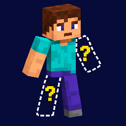
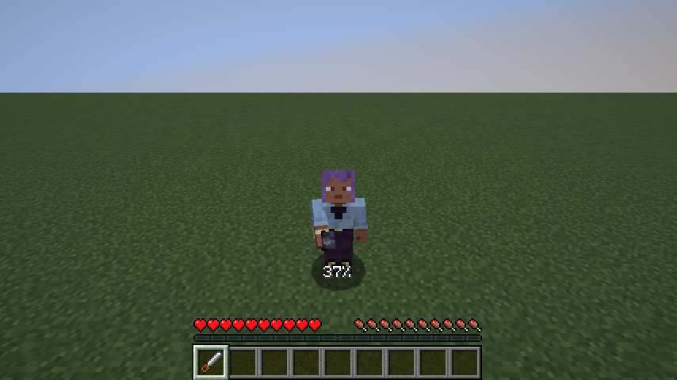
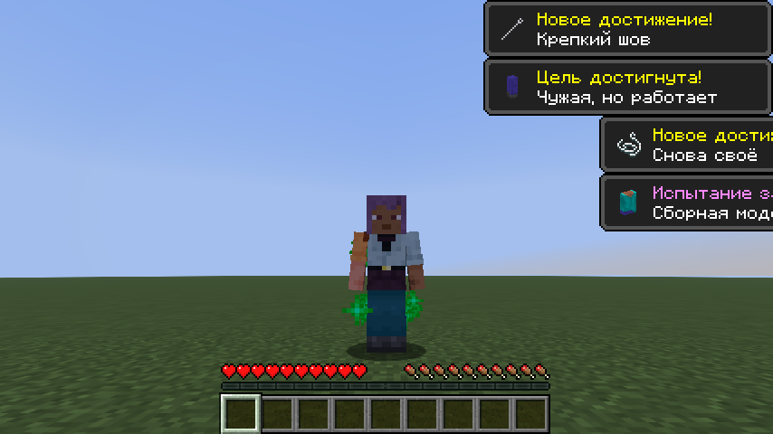
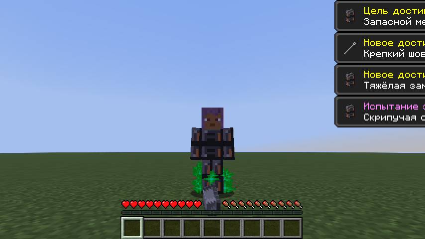

  

# Any Body Parts

**Minecraft 26.3 · Fabric · Fabric API · by kpkh**

[Русский](#русский) · [English](#english)

## Русский

Теряйте конечности, собирайте выпавшие части и пришивайте их обратно. Каждая рука и нога влияет на возможности игрока: одной рукой не натянуть лук, на одной ноге придётся прыгать, а без тела можно стать настоящим колобком. Голова остаётся всегда.

### Пила для конечностей

Железная пила позволяет отпилить выбранную часть у себя или другого игрока. **Shift + ПКМ** переключает часть, **удержание ПКМ** начинает операцию. На себе она занимает 4 секунды, на другом игроке — не меньше 10 секунд. Цель должна оставаться неподвижной; движение, урон или потеря дистанции прерывают операцию без расхода прочности.

Тело можно отпилить только после обеих рук и обеих ног, включая механические. Для этого не нужны права оператора: игроку без рук просто понадобится помощник с пилой. Части, отключённые глобально через конфиг, не считаются отпиленными.

### Пересадки и донорские скины

Отпиленная часть выпадает отдельным объёмным предметом и сохраняет своего донора. Её можно подобрать, передать другому игроку и пришить на подходящее свободное место. После пересадки часть продолжает отображать **скин исходного владельца**, даже если её снова отпилить.

Для пришивания нужны **иголка в основной руке**, **нитки во второй руке — в слоте щита**, подходящая часть в инвентаре и две работающие руки. Живые и механические руки подходят одинаково. Выберите часть через **Shift + ПКМ** и удерживайте **ПКМ** на себе или другом игроке. По умолчанию пришивание длится 5 секунд; материалы расходуются только при успехе.

### Механические части

Пять протезов заменяют левую и правую руку, левую и правую ногу и тело. У них свои объёмные модели с пиксельными металлическими текстурами. Они пришиваются той же иголкой, не требуют донора и снова выпадают протезами при отпиливании.

**Механические части всегда слабее живых.** Каждая рука снижает урон, скорость атак, добычи и ползания. Каждая нога замедляет движение и ослабляет прыжки. Механическое тело дополнительно замедляет игрока и не позволяет спринтовать или летать на элитрах. Штрафы за несколько частей перемножаются.

Протез конечности создаётся из незеритового блока, трёх железных слитков, поршня и редстоуна. Для тела нужны два незеритовых блока, четыре слитка, поршень и два редстоуна. Все рецепты доступны в книге рецептов после получения незеритового блока.

### Как меняется движение

| Что осталось | Как передвигаться |
|---|---|
| Две ноги | Обычная ходьба |
| Одна нога | Прыжки с направлением движения |
| Без ног, две руки | Ползание на руках |
| Без ног, одна рука | Более медленное ползание |
| Только тело и голова | Очень медленное передвижение телом |
| Только голова | Перекатывание без прыжков |

Без ног можно невысоко подпрыгивать, пока остались другие части кроме головы. Без рук нельзя пользоваться предметами или выбрасывать их через Q, в том числе из инвентаря.

## English

Lose limbs, collect detached parts and stitch them back on. Each arm and leg changes what your character can do: one arm cannot draw a bow, one leg means hopping, and losing your torso can turn you into a rolling head. Your head always remains.

### Limb saw

The iron limb saw removes individual body parts from yourself or another player. **Sneak + right-click** selects a part; **hold right-click** to operate. Self-surgery takes 4 seconds by default, while cutting another player takes at least 10 seconds. The patient must remain still. Movement, damage or losing range interrupts the operation without using durability.

The torso can only be removed after both arms and both legs, including mechanical limbs. Operator privileges are not required, but an armless patient needs someone else to hold the saw. Globally disabling limbs in the config does not count as removing them.

### Transplants and donor skins

Each severed part drops as a separate 3D item that remembers its donor. Pick it up, trade it and stitch it onto a matching missing body part. The transplant keeps the **original donor's skin**, even when removed again.

Sewing requires a **needle in your main hand**, **string in your offhand — the shield slot**, a matching part in your inventory and two working arms. Organic and mechanical arms both work. Select a part with **sneak + right-click**, then **hold right-click** on yourself or another player. Sewing takes 5 seconds by default and consumes supplies only when successful.

### Mechanical parts

Five prostheses replace the left and right arms, left and right legs and torso. They have their own 3D models with pixel-consistent metal textures. Attach them with the same needle, without a donor. Cutting them off drops the mechanical part again.

**Mechanical parts are always weaker than organic ones.** Each arm reduces damage, attack speed, mining speed and arm-powered crawling speed. Each leg slows movement and weakens jumps. A mechanical torso also slows movement and disables sprinting and elytra flight. Penalties from multiple parts multiply.

A limb costs one netherite block, three iron ingots, a piston and redstone dust. A torso costs two netherite blocks, four iron ingots, a piston and two redstone dust. Recipes unlock in the recipe book after obtaining a netherite block.

### Movement

| Remaining parts | Movement |
|---|---|
| Two legs | Walking |
| One leg | Directional hopping |
| No legs, two arms | Crawling on your arms |
| No legs, one arm | Slower crawling |
| Torso and head only | Very slow body-powered movement |
| Head only | Rolling, with no jumping |

Without legs, you can still make small jumps as long as something besides your head remains. Without arms, item use and manual item dropping are disabled, including Q inside the inventory.

[MIT License](LICENSE)
